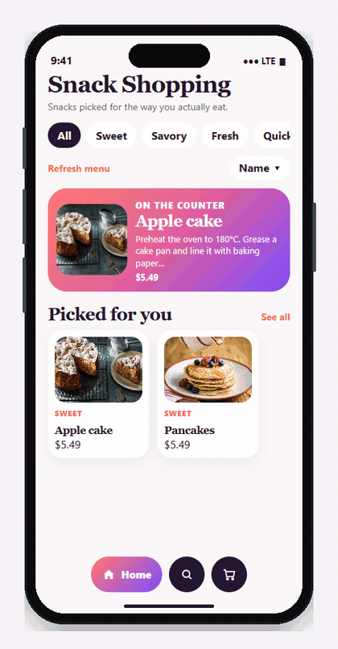

# Snack Shopping

Snack Shopping is an iPhone app for ordering snacks. Open a shelf, tap a snack, set a quantity, and check out for a morning, afternoon, or evening delivery.

The interaction ideas follow [Jetsnack](https://github.com/android/compose-samples/tree/main/Jetsnack), the Jetpack Compose sample from Android: a custom color system, a bottom bar whose selected item grows, category tiles on search, and a large photo on the snack page. Photos and prices come from public feeds.

## Project flow



The preview walks the iPhone screens: the home shelf, a search for pancakes, the apple cake page, two added to the bag, checkout for an afternoon delivery, and the receipt.

## Order flow

1. Home opens on rails: a pick based on snacks you just opened, plus sweet, savory, fresh, quick, and market shelves.
2. Search filters those shelves with tiles and matches names, blurbs, and ingredients.
3. A snack page shows the photo, the story, the ingredients, and where the price came from.
4. The bag keeps quantities, a delivery fee, and free delivery from $35.
5. Checkout asks for a name, an address, and a delivery window.
6. The receipt stays on the phone, with a short history of earlier orders.

## Prices and photos

Photos come from TheMealDB and DummyJSON. Prices come from Open Food Facts shelf prices, converted to US dollars with Frankfurter, or from DummyJSON grocery prices when a shelf name does not match. The snack page names the source. Details are in [docs/data-sources.md](docs/data-sources.md).

Delivery is the shop's own rule: $3.50, or free once snacks in the bag reach $35.

## Run

Open `SnackShopping.xcodeproj` in Xcode 15 or later. Choose an iPhone simulator and press Run. The project targets iOS 16 and iPhone only.

Simulator signing is turned off, so the app can launch without an Apple Developer team. Installing on a physical iPhone needs a team under Signing & Capabilities.

```bash
xcodebuild test -scheme SnackShopping -destination 'platform=iOS Simulator,name=iPhone 16'
```

The tests check price matching, the delivery threshold, recommendations, and the quantity limit.

## Layout

- `SnackShopping/Views` — home, search, snack, bag, checkout, and receipt
- `SnackShopping/Services/CatalogLoader.swift` — merges the public feeds
- `SnackShopping/Model/PriceMatch.swift` — chooses a USD price for a snack name
- `SnackShopping/Store` — menu, bag, saved snacks, and receipts on this phone
- `docs/design.md` — the color roles

## License

MIT. See [LICENSE](LICENSE).
